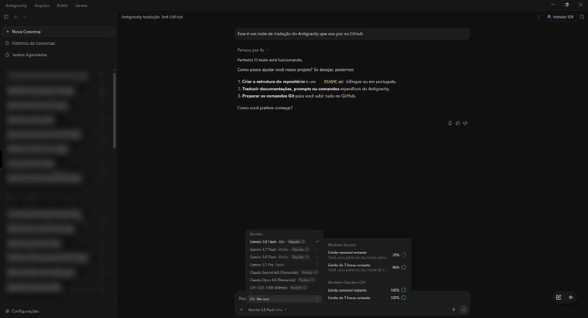
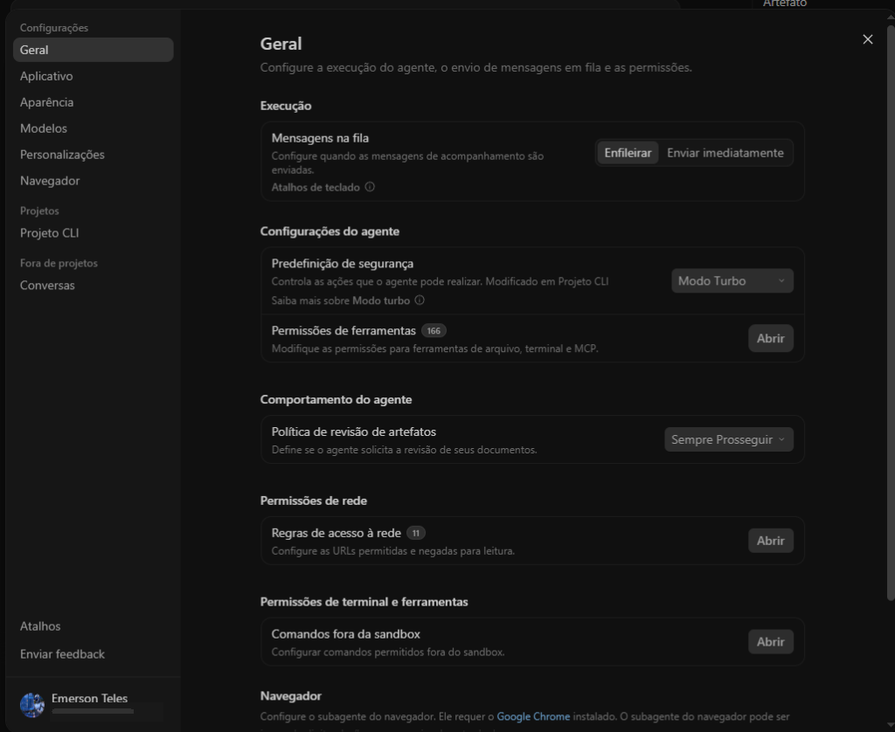

# 🌐 Google Antigravity — Tradução para Português do Brasil (PT-BR) 🇧🇷
### Versão de tradução 1.4.0 — Antigravity 2.24.0 — 18/10/2026
Localizados os textos das capturas e das descrições de plugins: visualizador biomolecular, Google Workspace, Firebase, Android CLI, Google Developer Knowledge, Google Cloud Developer, Google Maps Platform, Dart e Flutter, Data Agent Kit e Modern Web Guidance, além de limites, histórico, projetos, seletor de ambiente e ajuda jurídica. A revisão do texto copiado de Modern Web Guidance abrangeu 441 linhas e 5.016 palavras; 382 entradas de mapeamento foram acrescentadas ou ampliadas no catálogo desta revisão. Esse número conta mapeamentos, não palavras traduzidas. A compatibilidade estrutural do patch foi conferida no `app.asar` local 2.24.0; o frontend embarcado no pacote segue baseado em 2.23.0.

### Revisão do console — 13/10/2026
Lançadores CMD e scripts PowerShell exibem corretamente acentos e cedilhas. O bundle atualizado para o frontend do Antigravity 2.23.0 preserva o seletor e o modo Turbo durante a tradução.


-green?style=for-the-badge)

Pacote portátil de localização PT-BR do **Google Antigravity Desktop** para Português do Brasil (pt-BR). Tradução profunda cobrindo tanto o núcleo do aplicativo Electron (modular ASAR de 4.5 MB) quanto a interface web gráfica (`web-bundle`), diálogos de permissão, configurações, comandos de agentes, bandeja do sistema e painel de conversas.

<!-- antigravity-status -->
- Versão 1.4.0 (18/10/2026): 382 entradas de mapeamento acrescentadas ou ampliadas nesta revisão, incluindo descrições e prompts de plugins e textos das capturas. Instalador/restaurador integrados ao sidecar biomolecular 1.3.0, com 39 substituições de interface, pré-teste de versão e hashes, backup próprio e restauração protegida contra atualizações diferentes. O sincronizador alcança o cache de marketplaces e o pacote ativo em `~/.gemini/config/plugins/science`, usando `plugin.json` para validar a versão e um backup próprio para cada origem. Após o pré-teste, os atalhos encerram à força os processos da interface do Antigravity, preservam `language_server.exe`, usam console UTF-8 e limpam os caches. O ZIP inclui Node.js 24.21.0 portátil para Windows x64, evitando exigir instalação de Node.js e com validação de hash da distribuição oficial. A interface traduz “just now”, `2m ago`, `27d ago` e formatos compactos de semanas, meses e anos, além dos rótulos do seletor de projeto e ambiente e “Notice”; o backup temporário `main.js.bak` foi removido e não é distribuído.
- Revisão dos prints e auditoria de interface (13/10/2026): corrigidos Review, Nova guia, formulário de feedback, Política de revisão do plano, permissões globais, detalhamento de tokens, busca, Google Workspace, automação, plugin, WSL e Gemini 4 Argon. A auditoria analisou 834 candidatos e a varredura final não encontrou candidatos sem mapeamento. O observador acompanha alterações de texto/atributos em blocos incrementais por quadro; descrições truncadas recebem correspondência por prefixo. Crédito restaurado em Configurações → Versão, dentro do mesmo cartão da versão, com contorno cinza translúcido e texto turquesa #00adb5.
- Em 14/10/2026, o usuário confirmou o teste da tradução no Antigravity 2.23.0 e informou que está funcionando.
- Atualização de 14/10/2026: traduzidos Hide Whitespace Changes, Good Response, Bad Response, 6h ago e rótulos dinâmicos de linhas/itens adicionais; a proteção de editores foi restringida a seletores conhecidos para não ocultar rótulos de diff.
- Ajuste de desempenho do tradutor DOM (14/10/2026): a leitura inicial e as alterações dinâmicas agora são processadas em pequenos blocos por quadro, reduzindo picos que podiam congelar a interface; editores permanecem excluídos.
## Estado da atualização — 13/10/2026 · Antigravity 2.23.0

- O frontend correspondente ao Antigravity 2.23.0 foi incorporado ao pacote a partir do cache local do aplicativo. O seletor exibe Solicitar revisão, Padrão, Verificado (prévia), Automático (prévia) e Turbo. Já haviam sido acrescentadas 4 traduções para Vetted/Auto (prévia) e suas descrições. Nesta revisão, foram aplicadas diretamente no frontend mais 4 strings: Solicitar revisão, Padrão, o placeholder de pesquisa (“Pesquisar abas, arquivos, plugins, subagentes, artefatos e tarefas...”) e seu nome acessível. As descrições e a visibilidade do Turbo permanecem preservadas.
- A instalação oficial 2.23.0 não inclui `resources/web-bundle`; o instalador fornece essa pasta. O pacote agora usa o frontend carregado pela própria instalação 2.23.0, com a tabela de modos atual e Turbo preservado.
- O pré-teste estrutural valida a tabela atual do seletor, os rótulos traduzidos Solicitar revisão e Padrão, o placeholder de busca em PT-BR, as descrições de Request Review, Default e Turbo, o identificador `AgentPermissionPreset.TURBO` e a presença do modo Turbo na lista visível. Se algum ponto faltar, a instalação para antes de fechar o aplicativo, alterar o Fuse, criar backups ou substituir arquivos. A verificação da versão 2.23.0 foi aprovada.
- O pré-teste também valida o ponto de injeção de `dist/languageServer.js`; incompatibilidades são bloqueadas antes de modificar o app. Se uma falha inesperada ocorrer depois dessa validação, o instalador tenta restaurar os backups desta versão. Não há garantia para estruturas de versões futuras ainda não analisadas.
- Instalador e restaurador validam primeiro caminhos do processo, registro e locais conhecidos; só quando nenhum candidato válido contém Antigravity.exe e `resources\app.asar` iniciam a busca profunda em unidades fixas e removíveis. A busca ignora pastas raiz do sistema e junctions, deduplica caminhos, mantém instalações distintas selecionáveis e não usa a barra sobreposta do PowerShell. Mantenha `Find-Installations.ps1` ao lado dos scripts.
<!-- /antigravity-status -->

---

## 🎥 Vídeo Tutorial & Demonstração

<p align="center">
  <a href="https://www.youtube.com/watch?v=jZhrmjrK5p4" target="_blank">
    
  </a>
</p>

---

## 📸 Demonstração Visual

<p align="center">
  
  <br>
  <em>Interface Principal, navegação, modelos e chat 100% em Português do Brasil</em>
</p>

<p align="center">
  
  <br>
  <em>Painel de Configurações, Segurança, Execução, Permissões e Ferramentas totalmente localizado</em>
</p>

---

## 📋 Índice
1. [Sobre o Pacote](#-sobre-o-pacote)
2. [Vídeo Tutorial & Demonstração](#-vídeo-tutorial--demonstração)
3. [Demonstração Visual](#-demonstração-visual)
4. [O que Foi Traduzido](#-o-que-foi-traduzido)
5. [Estrutura da Pasta](#-estrutura-da-pasta)
6. [Como Instalar](#-como-instalar-em-2-cliques)
7. [Como Restaurar o Original de Fábrica](#-como-restaurar-o-original-de-fábrica)
8. [Sistema de Backup Modular e Segurança](#-sistema-de-backup-modular-e-segurança)
9. [Diretórios do Sistema](#-diretórios-no-computador)
10. [Padrão de Terminologia Oficial](#-padrão-de-terminologia-oficial)
11. [Créditos e Autoria](#-créditos-e-autoria)

---

## 🌟 Sobre o Pacote

Este pacote foi arquitetado para oferecer uma experiência nativa em português sem qualquer atrito:
* **Portátil e Autônomo:** Pode ser executado de qualquer pasta (ex: `C:\Projetos`, `Área de Trabalho`, `Downloads`, `Pen-drive`, `HD Externo`), sem requerer internet nem downloads extras.
* **Patcher dinâmico do núcleo Electron:** Detecta a versão instalada e preserva o número oficial. Para a versão 2.23.0, o pré-teste confere a tabela atual do seletor, a lista de modos visíveis e o identificador Turbo antes de qualquer alteração. Versões posteriores que mudarem essa estrutura são bloqueadas até o bundle ser atualizado.
* **Execução Independente e Desacoplada:** O inicializador integrado executa o aplicativo em processo isolado, sem poluir seu terminal com logs de debug e sem fechar o Antigravity ao fechar o script.
* **Segurança do Motor do Agente:** Preserva estritamente os processos em background do `language_server.exe` para que seus assistentes de IA nunca sejam interrompidos abruptamente.
* **Blindagem dos Editores de Chat:** Os componentes de texto rico (Lexical, Slate e Monaco Editor) são excluídos da tradução DOM; a varredura ocorre em blocos incrementais para preservar a responsividade.

---

## 🎯 O que Foi Traduzido

| Área | Elementos Traduzidos |
| :--- | :--- |
| **Tela de Boas-Vindas & Início** | "Bem-vindo ao Antigravity", tela de autenticação, botões de conta Google e Workspace, assistente de primeiro uso localizado. |
| **Barra Lateral & Histórico** | "Nova conversa", "Histórico de conversas", "Tarefas agendadas", "Projetos", "Fixados", "Recentes", filtros e pesquisa rápida. |
| **Painel de Chat & Mensagens** | Prompts do usuário, respostas do assistente, avaliação de passos, botão "Parar Tarefa", "Processo de pensamento...", botões de ação e feedback. |
| **Diálogos de Permissão** | Solicitações de autorização de terminal ("Solicitando sua permissão no Terminal:"), comandos shell, scripts JavaScript e abertura de URLs externas. |
| **Configurações Globais** | Menus de Aparência, Geral, Temas (Claro, Escuro, Sistema), Personalização de Regras, Habilidades (Skills), Sidecars e Servidores MCP. |
| **Menus Nativos do Windows** | Barra superior (Arquivo, Nova Janela, Editar, Exibir, Janela, Ajuda e "Verificar Atualizações"). |
| **Bandeja do Sistema (Tray)** | Status de agentes ativos ("Nenhum agente em execução", "X agentes em execução"), "Abrir Antigravity" e "Sair". |
| **Assistente da IDE & Setup** | Diálogos de onboarding, instalação da extensão no VS Code e configuração de rotas. |
| **Erros e Alertas do Agente** | Mensagens de diagnóstico ("Execução do agente encerrada devido a erro.", reconexão com servidor, erros de rede e avisos de limite). |

---

## 📂 Estrutura da Pasta

```text
<pasta-do-projeto>\
├── Instalar-Traducao.bat    # Atalho rápido: aplique a tradução com 2 cliques
├── Restaurar-Original.bat   # Atalho rápido: volte ao original de fábrica em 1 clique
├── aplicar-traducao.ps1     # Script mestre PowerShell com barra de progresso visual
├── restaurar-original.ps1   # Script de restauração modular e limpeza segura
├── patch-antigravity.cjs    # Motor dinâmico automatizado sem downgrade
├── tools/                   # Auditoria da interface e validação de backups
│   ├── scan-untranslated.cjs
│   ├── patch-plugin-empty-state.cjs
│   └── verify-clean-asar.cjs
├── app-pt.asar              # Gerado localmente; ignorado no Git por ser pacote compilado
├── web-bundle/              # Pacote da interface web gráfica traduzida (React/Tailwind)
│   ├── main.js              # Bundle da interface traduzida em PT-BR por Emerson Teles
│   ├── index.html           # Ponto de entrada da interface
│   ├── compiled_tailwind.css# Estilos visuais e temas
│   └── ...
├── README.md                # Este guia completo em formato Markdown moderno
├── README.ag                # Guia idêntico para visualizadores e editores integrados
├── AGENTS_PTBR.md           # Diretrizes operacionais para subagentes em Português
└── LEIA-ME.txt              # Manual em texto puro para visualização rápida no Bloco de Notas
```

---

## 🚀 Como Instalar (em 2 cliques)

1. Dê um duplo clique no arquivo:
   ```cmd
   Instalar-Traducao.bat
   ```
   *(Não precisa fechar o Antigravity antes: o instalador detecta e fecha o aplicativo automaticamente para aplicar a localização com total segurança).*
2. O instalador automático irá:
   - Instalador e restaurador validam primeiro caminhos do processo, registro e locais conhecidos; só quando nenhum candidato válido contém Antigravity.exe e `resources\app.asar` iniciam a busca profunda em unidades fixas e removíveis. A busca ignora pastas raiz do sistema e junctions, deduplica caminhos, mantém instalações distintas selecionáveis e não usa a barra sobreposta do PowerShell. Mantenha `Find-Installations.ps1` ao lado dos scripts.
   - Criar um backup de fábrica modular em `_backups\<versão>\app.asar`.
   - Executar o **Patcher Dinâmico**, instalando o núcleo traduzido (`app.asar`) e a interface gráfica web (`web-bundle`).
   - Renovar o cache do Chromium para que a tradução apareça de imediato.
3. Ao concluir, digite `S` para abrir o Antigravity com PT-BR. O bundle desta versão preserva os cinco perfis de execução, incluindo Turbo.

> [!NOTE]
> **Atualizações do aplicativo:** Sempre que o Google Antigravity receber uma atualização oficial, os arquivos originais serão reinstalados pelo próprio aplicativo. Para manter o programa em português, basta executar o `Instalar-Traducao.bat` novamente após a atualização.

---

## 🔄 Como Restaurar o Original de Fábrica

Se desejar retornar o Antigravity exatamente ao padrão original em inglês:
1. Dê um duplo clique no arquivo:
   ```cmd
   Restaurar-Original.bat
   ```
2. O restaurador detectará a versão instalada, recuperará o backup original de fábrica em `_backups\<versão>\app.asar` e restaurará o `web-bundle` original salvo para essa versão.
3. Seu Antigravity voltará a ser o original genuíno instantaneamente.

---

## 🛡️ Sistema de Backup Modular e Segurança

A integridade do seu aplicativo é prioridade máxima:
* **Backup de Fábrica Modular por Versão:** Antes de realizar qualquer alteração, o instalador cria uma cópia idêntica do `app.asar` original na pasta:
  `<pasta-do-Antigravity>\_backups\<versão>\app.asar`.
* **Proteção contra Sobrescrita:** O backup original de fábrica nunca é substituído nem apagado em instalações posteriores.
* **Reaplicação Segura:** O instalador compara o `web-bundle` instalado com o pacote atual e atualiza novas traduções, mantendo o backup original limpo da versão. Se detectar um `web-bundle` traduzido sem original correspondente, interrompe a instalação; restaure/reinstale a mesma versão original e execute novamente.
* **Pasta do Projeto:** Scripts, documentação e arquivos de tradução ficam juntos no projeto. Backups brutos são armazenados somente em `<pasta-do-Antigravity>\_backups\<versão>\`.
* **Preservação de Processos:** O `language_server.exe` nunca é finalizado abruptamente para garantir a continuidade dos agentes.

---

## 📍 Diretórios no Computador

* **Diretório do Aplicativo:**
  `%LOCALAPPDATA%\Programs\antigravity\`
* **Diretório de Recursos do Electron:**
  `%LOCALAPPDATA%\Programs\antigravity\resources\`
* **Pasta Segura de Backup Original:**
  `%LOCALAPPDATA%\Programs\antigravity\_backups\`
* **Diretório de Dados e Configurações:**
  `%USERPROFILE%\.gemini\antigravity\`

---

## 📐 Padrão de Terminologia Oficial

Este pacote segue rigorosamente os padrões de qualidade e naturalidade definidos por **Emerson Teles**:
* **"aplicativo" / "aplicativos"** — Usado sempre; nunca "app" ou "apps" isolados.
* **"tokens"** — Mantido tecnicamente correto; nunca traduzido para "fichas".
* **"Direcionar"** — Tradução precisa para a função *Steer*.
* **"ativar" / "desativar"** — Padronizado no lugar de "habilitar / desabilitar".
* **"espaço de trabalho"** — Tradução consistente para *workspace*.

---

## ✍️ Créditos e Autoria

* **Tradução PTBR - Emerson Teles**
* **Engenharia e Arquitetura:** Emerson Teles
* **Localização:** Português do Brasil (`pt-BR`)
* **Distribuição:** Pacote portátil, autônomo e de alta confiabilidade.

*Google Antigravity é uma marca registrada da Google LLC. Este pacote de tradução é uma personalização desenvolvida de forma independente por Emerson Teles.*

---

## 👨‍💻 Sobre o Autor

Desenvolvido e mantido por **Emerson Teles** (conhecido na comunidade como **Emertels**).

Entusiasta de tecnologia, informática, jogos, manutenção de sistemas e tradução/localização de softwares para Português do Brasil (PT-BR). Desenvolvedor focado em utilitários práticos, ferramentas de produtividade, automação inteligente em PowerShell e soluções completas de localização técnica que aproximam ferramentas modernas do público brasileiro.

### 🛠️ Projetos & Contribuições

- [AI-Chat-Vault](https://github.com/Emertels/AI-Chat-Vault) — Backup portátil e recuperação de conversas locais de 20+ ferramentas e assistentes de IA.
- [Antigravity — Tradução PT-BR](https://github.com/Emertels/Antigravity-Traducao-PTBR) — Localização completa do Google Antigravity Desktop para Português do Brasil.
- [Codex Router — Tradução PT-BR](https://github.com/Emertels/CodexRouter-Traducao-PTBR) — Pacote de tradução e localização do Codex Router Control Center em PT-BR.
- [Cursor AI — Tradução PT-BR](https://github.com/Emertels/Cursor-Traducao-PTBR) — Localização completa e profunda do Cursor AI para Português do Brasil.
- [Devin AI — Tradução PT-BR](https://github.com/Emertels/Devin-Traducao-PTBR) — Tradução e localização completa do Devin Desktop para Português do Brasil.
- [GPU Tweak III — Tradução PT-BR](https://github.com/Emertels/GPU-Tweak-III-Traducao-PTBR) — Tradução em português brasileiro e instalador automatizado para ASUS GPU Tweak III.
- [Microsoft Photos Fix](https://github.com/Emertels/Microsoft-Photos-Fix) — Solução definitiva em PowerShell e C# para rota de inicialização rápida e visualização no app Fotos do Windows.
- [PSBBN-Translator](https://github.com/Emertels/PSBBN-Translator) — Suíte corporativa de tradução e localização para o PSBBN Definitive Project (PlayStation 2) em 40 idiomas.
- [Silent Hill: Homecoming — Tradução PT-BR](https://github.com/Emertels/Silent-Hill-Homecoming-Traducao-PTBR) — Tradução e revisão completa do jogo para PC em português brasileiro.
- [Suite-Emuladores](https://github.com/Emertels/Suite-Emuladores) — Suíte inteligente em PowerShell para download e atualização autônoma de 56 emuladores e frontends no Windows.
- [ZCode — Tradução PT-BR](https://github.com/Emertels/ZCode-Traducao-PTBR) — Tradução e localização completa do ZCode Desktop para Português do Brasil.

### 🌐 Conecte-se comigo & Comunidades Oficiais

<div align="left">

[](https://github.com/emertels)
[](https://emertels.github.io)
[](https://emertels.github.io/discord)
[](https://x.com/emertels)
[](https://www.youtube.com/@emersonteles2379)
[](https://t.me/apksmodsandroid)
[](https://ko-fi.com/emertels)

</div>
